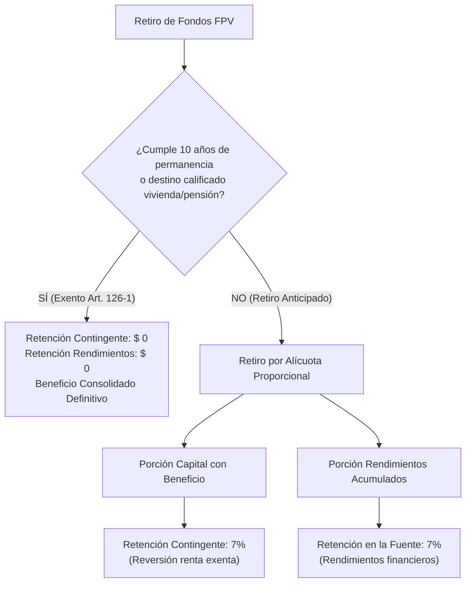

# Guía Financiera y Tributaria de Inversiones (Colombia)

Manual integral sobre el modelo de cálculo financiero, retenciones en la fuente, Gravamen a los Movimientos Financieros (GMF 4x1000) e impacto en el Impuesto sobre la Renta para personas naturales residentes en Colombia, según la legislación vigente (Estatuto Tributario, Ley 2277 de 2022, Decreto 1625 de 2016, Decreto 572 de 2025 y valor UVT 2026: **$ 52.374 COP**).

---

## Tabla Resumen Comparativa de los 6 Productos

| Producto | Rentabilidad / Base de Cálculo | Retención en la Fuente | GMF (4x1000) | Declaración de Renta |
| :--- | :--- | :--- | :--- | :--- |
| **1. CDT / CDAT** | Tasa fija (% E.A. o Nominal) sobre capital a término cerrado. | **4 %** sobre rendimiento bruto al vencimiento o abono. | Exento si se traslada a cuenta del titular; 0,4 % si se retira en cheque o cuenta tercera. | Cédula general (rentas de capital). Aplica componente inflacionario si está decretado. |
| **2. Cuenta de Alto Rendimiento** | Tasa fija (% E.A.) capitalizable por saldo diario o mensual. | **7 %** sobre rendimientos si superan **0,055 UVT/día** ($ 2.880/día). De lo contrario, **0 %**. | **Exento** hasta **350 UVT/mes** ($ 18.330.900) si es la cuenta marcada. Sin marcar: 0,4 % pleno. | Cédula general (rentas de capital). |
| **3. Acciones y ETFs** | Precio de cotización bursátil + Dividendos decretados (Costo Promedio Ponderado). | • Venta BVC: **0 %** (Art. 36-1 E.T. si $\le$ 3% de circulación). • Dividendos BVC: **0 %** hasta 1.090 UVT; **15 %** sobre exceso. • Exterior: retención en origen + local (hasta 30%). | 0 % en transacciones bursátiles comisionista a comisionista. | • $\ge$ 2 años: Ganancia Ocasional (**15 %**). • < 2 años: Renta ordinaria (tarifa marginal 0–39 %). |
| **4. Fondos de Inversión Colectiva (FIC)** | Portafolio administrado por riesgo (Bajo 4–7%, Medio 6–12%, Alto -10 a 20% E.A.). | Tarifa ponderada del fondo (**6,10 %** promedio) aplicada **únicamente a la utilidad acumulada** al redimir. | Generalmente exento en traslados entre fondos de la misma fiduciaria. | Cédula general. Los rendimientos no realizados gozan de diferimiento fiscal. |
| **5. Pensiones Voluntarias (FPV)** | Portafolio administrado por riesgo (Bajo, Medio, Alto). Aporte reduce base gravable. | • Con permanencia $\ge$ 10 años o compra vivienda: **0 %**. • Retiro anticipado: **7 %** sobre aportes con beneficio + **7 %** sobre rendimientos. | **0 %** (Exento por ley en retiros de FPV). | • Entrada: Renta exenta hasta el menor entre 30 % de ingresos y 3.800 UVT. • Retiro sin permanencia: Se revierte la exención. |
| **6. Cesantías** | Rendimientos administrados por el fondo privado (Ley 50) o interés legal anual. | **0 %** de retención al momento del desembolso o retiro. | **0 %** (Exento por ley para retiro de cesantías). | Exención gradual según salario promedio últimos 6 meses (Art. 206 #4): 100 % exento si salario $\le$ 350 UVT. |

---

## 1. Certificado de Depósito a Término (CDT / CDAT)

### 1.1 Modelo Financiero
Instrumento de renta fija a plazo determinado ($d$ días entre 30 y 3.650) con base de cálculo bancaria ($B = 365$ días) o comercial ($B = 360$ días).

* **Conversión de Tasa Nominal a Efectiva Anual (E.A.):**
  $$EA = \left(1 + \frac{i_{nominal}}{m}\right)^m - 1$$
* **Rendimiento Bruto al Vencimiento ($R_{bruto}$):**
  $$R_{bruto} = Capital \times \left[(1 + EA)^{\frac{d}{B}} - 1\right]$$
* **Rendimiento Neto:**
  $$R_{neto} = R_{bruto} - Retenci\acute{o}n$$
* **Rentabilidad Neta Efectiva Anual Real:**
  $$EA_{neta} = \left(\frac{Capital + R_{neto}}{Capital}\right)^{\frac{B}{d}} - 1$$

### 1.2 Esquema Tributario e Impuestos

1. **Retención en la Fuente Oficial (4 %):**
   * **Norma:** Art. 395 del Estatuto Tributario y **Decreto 572 de 2025**.
   * **Base:** Se practica directamente sobre el 100 % del rendimiento financiero bruto generado.
   * **Tarifa:** **4,00 %**.
   * **Fórmula:**
     $$Retenci\acute{o}n = R_{bruto} \times 4\%$$
2. **Gravamen a los Movimientos Financieros (GMF 4x1000):**
   * La cancelación o abono de capital e intereses en una cuenta de la misma entidad financiera y del mismo titular está exenta de 4x1000 (Art. 879 Num. 14 E.T.). Si se abona a terceros o se gira en cheque de gerencia, aplica el 0,4 %.
3. **Impuesto sobre la Renta (Declaración Anual):**
   * Cédula General — Subcédula de Rentas de Capital.
   * **Componente Inflacionario (Arts. 38 y 40-1 E.T.):** La porción del rendimiento que corresponda a la inflación decretada por la DIAN para el año gravable constituye **Ingreso No Constitutivo de Renta ni Ganancia Ocasional (INCRGO)**. El resto tributa a la tarifa marginal del contribuyente (0 % al 39 %), pudiéndose descontar la retención del 4 % ya practicada.

#### Caso Práctico
* **Inversión:** $ 20.000.000 COP a 180 días con tasa 11,50 % E.A. (Base 365 días).
* Factor: $(1 + 0,115)^{\frac{180}{365}} - 1 = 5,4967\%$
* Rendimiento Bruto: $\$ 20.000.000 \times 5,4967\% = \mathbf{\$ 1.099.340 COP}$
* Retención 4 %: $\$ 1.099.340 \times 4\% = \mathbf{-\$ 43.974 COP}$
* Monto Neto Recibido: $\$ 20.000.000 + \$ 1.055.366 = \mathbf{\$ 21.055.366 COP}$

---

## 2. Cuenta de Alto Rendimiento (Ahorro Remunerado)

### 2.1 Modelo Financiero
Cuenta de depósito a la vista que genera rendimientos diarios sobre el saldo disponible, capitalizados o abonados periódicamente (mensual o diario).

* **Interés Compuesto del Periodo:**
  $$I_{bruto} = Saldo \times \left[(1 + EA)^{\frac{d}{B}} - 1\right]$$

### 2.2 Esquema Tributario e Impuestos

1. **Retención en la Fuente sobre Rendimientos (7 % con Base Mínima):**
   * **Norma:** Art. 395 E.T. y Art. 1.2.4.2.1 del Decreto 1625 de 2016.
   * **Umbral de Exoneración Diaria:** No se practica retención si el rendimiento del periodo no supera **0,055 UVT por día** ($ 2.880,57 COP/día en 2026).
   * **Condición:**
     $$\text{Si } I_{bruto} < (d \times 0,055 \times UVT) \implies Retenci\acute{o}n = \$ 0$$
     $$\text{Si } I_{bruto} \ge (d \times 0,055 \times UVT) \implies Retenci\acute{o}n = I_{bruto} \times 7\%$$
2. **Gravamen a los Movimientos Financieros (GMF 4x1000):**
   * **Cuenta Marcada como Exenta (Art. 879 Num. 1 E.T.):** Los retiros mensuales acumulados hasta **350 UVT ($ 18.330.900 COP en 2026)** están **100 % exentos de GMF**.
   * **Exceso sobre 350 UVT:** Paga **0,4 %** sobre el excedente retirado en el mes calendario:
     $$GMF = (RetirosAcumulados - 350 \times UVT) \times 0,4\%$$
   * **Cuenta No Exenta:** Paga el 0,4 % pleno sobre cada retiro desde el primer peso.
3. **Impuesto sobre la Renta:**
   * Cédula General — Rentas de Capital. Aplica componente inflacionario anual decretado por el Gobierno Nacional.

---

## 3. Acciones y Fondos Cotizados (ETFs / Renta Variable)

### 3.1 Modelo Financiero
Inversión en títulos de renta variable local (Bolsa de Valores de Colombia - BVC) o internacional (Mercados extranjeros / NYSE / NASDAQ).

* **Costo Promedio Ponderado Unitario ($CPP$):**
  $$CPP = \frac{CostoAnterior + (UnidadesNuevas \times PrecioCompra) + Comisi\acute{o}n}{UnidadesTotales}$$
* **Utilidad en Enajenación (Venta):**
  $$Utilidad = (UnidadesVendidas \times PrecioVenta \times TRM_{venta}) - (UnidadesVendidas \times CPP \times TRM_{compra}) - Comisi\acute{o}n$$

### 3.2 Esquema Tributario por Escenarios

#### Caso A: Venta de Acciones Inscritas en la BVC (Beneficio Art. 36-1 E.T.)
* **Condición:** La acción debe estar inscrita en la BVC y la venta no puede superar el **3 % de las acciones en circulación** de la empresa en el mismo año gravable.
* **Impacto Tributario:** **0 % Impuesto (Ingreso No Constitutivo de Renta ni Ganancia Ocasional)**. La ganancia es 100 % libre de impuestos.

#### Caso B: Venta de Acciones del Exterior o ETFs
* **Tenencia $\ge$ 2 Años (Ganancia Ocasional):**
  * **Tarifa Única:** **15 %** sobre la utilidad neta realizada (Arts. 300 y 314 E.T.).
* **Tenencia < 2 Años (Renta Ordinaria):**
  * La utilidad se suma a la Cédula General y tributa a la tarifa marginal del contribuyente (**0 % al 39 %** según tabla del Art. 241 E.T.).
* **Si hay Pérdida en Venta:** No genera impuesto ni retención; se informa en la declaración de renta y puede compensarse contra ganancias de la misma naturaleza.

#### Caso C: Tratamiento de Dividendos (Art. 242 E.T. / Ley 2277 de 2022)
1. **Dividendos de Sociedades Nacionales (BVC):**
   * Hasta **1.090 UVT ($ 57.087.660 COP en 2026)**: **Tarifa 0 %**.
   * Exceso sobre 1.090 UVT: Retención en la fuente del **15 %** sobre la porción excedente:
     $$Retenci\acute{o}n = (DividendoCOP - 1.090 \times UVT) \times 15\%$$
2. **Dividendos Internacionales (ETFs / Acciones EE.UU.):**
   * Retención en origen (*tax withholding* internacional): Típicamente **15 %** a **30 %** (según tratado o formulario W-8BEN).
   * En Colombia se integran a la Cédula General, pudiendo imputar el impuesto pagado en el exterior como descuento tributario (Art. 254 E.T.).

---

## 4. Fondos de Inversión Colectiva (FIC)

### 4.1 Modelo Financiero y Portafolios
El capital se invierte en una cartera colectiva diversificada administrada por una Fiduciaria o Comisionista de Bolsa según el perfil de riesgo:
* **Bajo:** Rango esperado **4 % a 7 % E.A.** (Títulos de deuda pública TES, CDT, depósitos a la vista).
* **Medio:** Rango esperado **6 % a 12 % E.A.** (Renta fija corporativa, bonos tasa flotante, FPV).
* **Alto:** Rango esperado **-10 % a 20 % E.A.** (Renta variable local y global, ETFs indexados).

### 4.2 Esquema Tributario e Imputación al Retiro
Los FIC operan bajo el principio de **transparencia fiscal** y **diferimiento de impuestos**:
1. **Durante la permanencia (Valorización diaria):** El aumento de valor de la inversión **no genera retención en la fuente ni impuesto de renta** mientras no se redima.
2. **Al momento de la Redención (Retiro):**
   * **Regla de Imputación Prioritaria a Utilidades (Art. 1.2.4.2.78 Dec. 1625/2016):**
     * Primero se retiran las utilidades acumuladas pendientes ($U = ValorActual - AportesNetos$).
     * Sobre las utilidades retiradas se practica la **Tarifa Ponderada de Retención** del fondo (promedio de la canasta, típicamente **6,10 %**).
     * El saldo retirado que exceda la utilidad constituye **Reembolso de Capital no gravado** (0 % retención).
     $$Retenci\acute{o}n = \min(MontoRetiro, UtilidadPendiente) \times TarifaPonderada$$
3. **GMF (4x1000):** Exento en transferencias entre fondos de la misma sociedad administradora o hacia cuentas bancarias registradas del mismo titular.

---

## 5. Fondos de Pensiones Voluntarias (FPV)

### 5.1 Modelo Financiero y Beneficio al Ingreso
Instrumento de ahorro previsional y planeación tributaria que permite deducir aportes de la base del Impuesto sobre la Renta.

* **Tope de Renta Exenta al Aportar (Art. 126-1 E.T.):**
  * Los aportes voluntarios son renta exenta en el año en que se realizan hasta el **menor valor entre:**
    1. El **30 % del ingreso laboral o tributario anual** del contribuyente.
    2. **3.800 UVT anuales ($ 199.021.200 COP en 2026)**.

### 5.2 Esquema Tributario en Retiros y Casos

#### Caso 1: Retiro Cumpliendo Requisitos Legales
* **Condiciones:**
  1. Permanencia mínima de **10 años continuos** del aporte; o
  2. Destinación exclusiva para **adquisición de vivienda** del partícipe (vía crédito hipotecario o *leasing* habitacional); o
  3. Cumplimiento de requisitos de edad/semanas para pensión de vejez o invalidez.
* **Tributación:** **0 % Retención**. Los rendimientos retirados no constituyen renta ni ganancia ocasional.

#### Caso 2: Retiro Anticipado sin Permanencia
Si se retira el dinero antes de los 10 años y sin destino de vivienda, se pierden los beneficios y se aplican dos retenciones simultáneas:
1. **Retención Contingente sobre Aportes (7 %):**
   * Aplica sobre la porción del capital retirado que haya gozado de beneficio fiscal al ingresar (Art. 1.2.4.1.33 Decreto 1625/2016).
   * Los aportes que ingresaron sin beneficio (por exceder topes) no sufren retención contingente.
2. **Retención en la Fuente sobre Rendimientos (7 %):**
   * Aplica sobre la porción de rendimientos acumulados generados en el fondo.
3. **GMF (4x1000):** **0 %** (Exento por ley en retiros de FPV según Art. 879 E.T.).

* **Regla de Alícuota Proporcional en Retiros Parciales:**
  El retiro no liquida primero solo capital ni solo rendimientos; se distribuye proporcionalmente al saldo del fondo:
  $$Proporci\acute{o}n_{rend} = \frac{RendimientosAcumulados}{SaldoTotal}$$
  $$Retenci\acute{o}n_{total} = (CapitalRetirado \times 7\%) + (RendimientosRetirados \times 7\%) = MontoRetiro \times 7\%$$

---

## 6. Fondos de Cesantías

### 6.1 Modelo Financiero
Prestación social obligatoria depositada anualmente por el empleador en un fondo administrador (Ley 50 de 1990) o administrada por entidades oficiales (Fondo Nacional del Ahorro - FNA).

### 6.2 Esquema Tributario e Impuestos

1. **Retención en la Fuente al Desembolso:**
   * **Tarifa:** **0,00 % en todos los casos** (Art. 206 Numeral 4 E.T.). Ninguna administradora practica retención en la fuente al entregar cesantías al trabajador.
2. **Gravamen a los Movimientos Financieros (GMF 4x1000):**
   * **Tarifa:** **0,00 %** (Exento expresamente por el Art. 879 Numeral 3 E.T.).
3. **Impuesto sobre la Renta (Declaración Anual — Cédula General):**
   * Las cesantías se declaran en el año en que son consignadas al fondo o pagadas directamente al trabajador.
   * **Tabla de Exención Gradual (Art. 206 Num. 4 E.T.):** La exención se determina según el **salario mensual promedio de los últimos 6 meses**:

| Salario Promedio Últimos 6 Meses (UVT) | Salario Promedio 2026 (COP) | Porcentaje Renta Exenta | Porcentaje Gravado (Renta Ordinaria) |
| :--- | :--- | :--- | :--- |
| **Hasta 350 UVT** | Hasta **$ 18.330.900** | **100 % Exento** | **0 %** |
| **De >350 a 410 UVT** | $ 18.330.901 a $ 21.473.340 | **90 % Exento** | 10 % |
| **De >410 a 470 UVT** | $ 21.473.341 a $ 24.615.780 | **80 % Exento** | 20 % |
| **De >470 a 530 UVT** | $ 24.615.781 a $ 27.758.220 | **60 % Exento** | 40 % |
| **De >530 a 590 UVT** | $ 27.758.221 a $ 30.900.660 | **40 % Exento** | 60 % |
| **De >590 a 650 UVT** | $ 30.900.661 a $ 34.043.100 | **20 % Exento** | 80 % |
| **Mayor a 650 UVT** | Mayor a **$ 34.043.100** | **0 % Exento** | **100 % Gravado** |

---

## Parámetros Normativos de Referencia (Vigencia 2026)

| Clave del Parámetro | Valor Oficial | Norma de Referencia |
| :--- | :--- | :--- |
| `UVT` | **$ 52.374 COP** | Resolución DIAN oficial 2026 |
| `RETEFUENTE_RENTA_FIJA` (CDT) | **4,00 %** | Art. 395 E.T. / Decreto 572 de 2025 |
| `RETEFUENTE_REND_FINANCIEROS` | **7,00 %** | Art. 395 Estatuto Tributario |
| `RETEFUENTE_CUENTA_AHORRO_BASE_DIARIA_UVT` | **0,055 UVT/día** | Art. 1.2.4.2.1 Decreto 1625 de 2016 |
| `GMF_TARIFA` (4x1000) | **0,40 %** | Art. 871 Estatuto Tributario |
| `GMF_TOPE_EXENTO_UVT` | **350 UVT** ($ 18.330.900) | Art. 879 Numeral 1 Estatuto Tributario |
| `GO_TARIFA` (Ganancia Ocasional) | **15,00 %** | Art. 314 Estatuto Tributario (Ley 2277/2022) |
| `GO_ANIOS_TENENCIA` | **2 años** | Art. 300 Estatuto Tributario |
| `ART_36_1_TOPE_PORC_CIRCULACION` | **3,00 %** | Art. 36-1 Estatuto Tributario |
| `DIVIDENDOS_UMBRAL_UVT_BVC` | **1.090 UVT** ($ 57.087.660) | Art. 242 Estatuto Tributario (Ley 2277/2022) |
| `DIVIDENDOS_TARIFA_EXCESO_BVC` | **15,00 %** | Art. 242 Estatuto Tributario |
| `FPV_TOPE_PORC_INGRESO` | **30,00 %** | Art. 126-1 Estatuto Tributario |
| `FPV_TOPE_UVT` | **3.800 UVT** ($ 199.021.200) | Art. 126-1 Estatuto Tributario |
| `FPV_PERMANENCIA_ANIOS` | **10 años** | Art. 126-1 Estatuto Tributario |
| `FPV_RETENCION_RETIRO_ANTICIPADO` | **7,00 %** | Art. 1.2.4.1.33 Decreto 1625 de 2016 |
| `CESANTIAS_UMBRAL_UVT` | **350 UVT** ($ 18.330.900) | Art. 206 Numeral 4 Estatuto Tributario |

